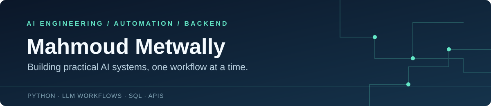

### AI engineering student · Builder of practical AI workflows

I study AI Engineering at **Galala University**. My work brings together machine learning, LLM-powered automation, and backend development — from document extraction pipelines to applications that make data easier to use.

[LinkedIn](https://www.linkedin.com/in/mahmoud-metwally-709221375) · [Explore my repositories](https://github.com/Metwally99?tab=repositories)

---

## Selected work

### DocMind · Document question answering
**Backend Engineering Internship · EVAS**

Built a document assistant with PDF ingestion, vector retrieval, and streamed answers with source citations. The application combines a React interface with a secured Node.js API and PostgreSQL with pgvector.

`React` `Node.js` `PostgreSQL` `pgvector` `Docker`

### [PulseCore · Regulatory document automation](https://github.com/Metwally99/pulsecore-case-study)
**AI Engineering Internship · GIG Insurance Egypt**

Built a workflow to monitor the Egyptian FRA portal and extract structured data from scanned Arabic insurance-broker decrees, with validation, correction, and human review.

`Python` `Gemini Vision` `Flask` `SQLite` `Excel` · **[Read the case study →](https://github.com/Metwally99/pulsecore-case-study)**

### [Agentic-DB · Conversational database assistant](https://github.com/Metwally99/agentic-db)
**Team project**

Contributed to an assistant that translates natural-language requests into database tool calls, with read-only controls and review of staged changes.

`Python` `LLM tool calling` `SQL` `Flask` · **[Explore the repository →](https://github.com/Metwally99/agentic-db)**

### [IoTBlue · HR management system](https://github.com/Metwally99/iotblue-hr-system)

A full-stack system for employee, attendance, and leave management, combining a Go API, PostgreSQL, and a React frontend.

`Go` `PostgreSQL` `React` `Docker` · **[Explore the repository →](https://github.com/Metwally99/iotblue-hr-system)**

### More projects

- **[NexusTrade](https://github.com/Metwally99/nexustrade-kbs)** — A knowledge-based trading system using rules, a graph database, and Flask.
- **[House Price ML](https://github.com/Metwally99/house-price-ml)** — House-price prediction using neural networks and a Flask interface.
- **[SMS Spam Detection](https://github.com/Metwally99/nlp-sms-spam-detection)** — Text preprocessing, TF-IDF features, and classification models.

---

## Tools I work with

**AI & data**  Python · PyTorch · scikit-learn · pandas · NumPy · OpenCV  
**Applications**  JavaScript · React · Node.js · Express · Flask · Go  
**Data & delivery**  SQL · PostgreSQL · SQLite · Git · Docker

